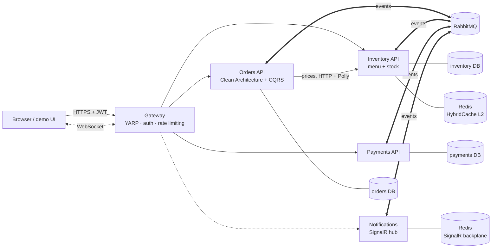
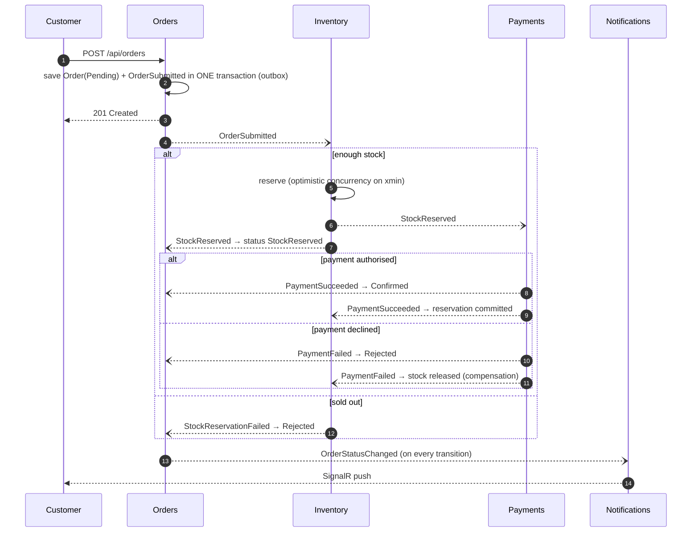

# LankaEats

An event-driven food-ordering platform for Sri Lanka, built as .NET 10 microservices.
An order goes through stock reservation and payment across separate services. If payment fails, the
reserved stock is put back (compensation). The customer watches the status change live in the browser.

**Everything runs on free tooling.** Locally it's `docker compose up`. In the cloud it runs on the Azure
Container Apps free allowance plus free tiers of Neon, CloudAMQP and Upstash.

    

---

## Architecture



Each service owns its own database, so no service reads another's tables. They communicate through
integration events defined in `LankaEats.Contracts`.

### The order saga (choreography)



---

## What's inside

| Concern | Implementation |
|---|---|
| Services | ASP.NET Core 10 minimal APIs: **Orders**, **Inventory**, **Payments**, **Notifications** |
| API gateway | **YARP** reverse proxy: one entry point, JWT validation, per-user/IP **rate limiting**, WebSocket proxying |
| Messaging | **RabbitMQ** + **MassTransit 8** (Apache-2.0), explicit queue names, retry policy, `_error` queues |
| Reliability | **Transactional outbox** (no dual writes) and **inbox** (idempotent consumers) via MassTransit EF Core outbox |
| Architecture | **Clean Architecture** in Orders (Domain / Application / Infrastructure / Api), vertical slices in the simpler services |
| CQRS | **MediatR 12** (Apache-2.0) commands/queries + **FluentValidation** pipeline behaviour |
| Data | **EF Core 10 + PostgreSQL**, database per service, migrations, `xmin` optimistic concurrency, JSON columns |
| Caching | **HybridCache** (in-memory L1 + **Redis** L2) for the menu, with stampede protection |
| Real-time | **SignalR** with strongly typed hub, JWT over WebSockets, **Redis backplane** for scale-out |
| Resilience | `Microsoft.Extensions.Http.Resilience` (Polly: retry, circuit breaker, timeout) on service-to-service HTTP |
| Auth | JWT bearer, role-based policies (`customer`, `admin`), resource ownership checks |
| Observability | **OpenTelemetry** traces, metrics and logs → OTLP (.NET Aspire dashboard locally). One trace follows an order across all services through RabbitMQ |
| Health | `/health/live` and `/health/ready` (DB + broker checks) wired to container probes |
| Errors | RFC 9457 **ProblemDetails** for every error |
| Tests | **xUnit** unit tests + **Testcontainers** integration tests against real PostgreSQL and RabbitMQ |
| CI/CD | **GitHub Actions**: build → unit tests → integration tests → Docker images to GHCR, plus a manual Azure deploy (OIDC) |
| Infra as code | **Bicep** for Azure Container Apps with scale-to-zero and **KEDA RabbitMQ** scale rules |

---

## Quick start

Prerequisites: Docker Desktop. The .NET 10 SDK is optional and only needed to run tests or debug.

```bash
docker compose up --build
```

| URL | What |
|---|---|
| http://localhost:8080 | Demo UI + API gateway |
| http://localhost:18888 | Aspire dashboard: distributed traces, structured logs, metrics |
| http://localhost:15672 | RabbitMQ management (guest / guest) |

### Try these scenarios in the UI

1. **Happy path:** sign in as a customer, add Chicken Kottu, pay by card. Watch *Pending → StockReserved → Confirmed* arrive live.
2. **Compensation:** pay with *Test card (always declined)*. The order is *Rejected*, and the stock you reserved reappears on the menu.
3. **Sold out:** order 6 × Fish Ambul Thiyal (only 5 in stock).
4. **Card limit:** a card order over LKR 25,000 is declined by the payment simulator.
5. **Restaurant side:** open a second browser window and sign in as *Restaurant admin*. You see every order live and can advance it *Preparing → OutForDelivery → Delivered*. The customer's window updates instantly.
6. **Observability:** open the Aspire dashboard → Traces and click a `POST /api/orders` trace. It spans gateway → orders → RabbitMQ → inventory → payments → notifications.

`requests.http` has the same flows as raw HTTP calls.

### Run services from your IDE instead

```bash
docker compose up postgres rabbitmq redis dashboard
```

Then run each project (`dotnet run --project src/Services/Orders/Orders.Api` etc.). Ports: gateway 5000, orders 5101,
inventory 5102, payments 5103, notifications 5104. Set `OTEL_EXPORTER_OTLP_ENDPOINT=http://localhost:4317` if you
map the dashboard's OTLP port.

---

## Tests

```bash
dotnet test tests/Orders.UnitTests          # domain rules, handler, validation (fast, no Docker)
dotnet test tests/Orders.IntegrationTests   # real PostgreSQL + RabbitMQ via Testcontainers (needs Docker)
```

The integration tests start the real Orders API with `WebApplicationFactory`. They check that:
- placing an order really delivers `OrderSubmitted` to RabbitMQ **through the outbox**
- the saga events drive the order to *Confirmed* / *Rejected*
- **duplicate and out-of-order events** don't corrupt state
- validation returns ProblemDetails, missing tokens get 401, other customers' orders return 404, and customers can't use admin actions

---

## Project structure

```
src/
  BuildingBlocks/
    LankaEats.Contracts/         integration events: the public contract between services
    LankaEats.ServiceDefaults/   OpenTelemetry, JWT, health, MassTransit + outbox, migrations
  Services/
    Orders/
      Orders.Domain/             Order aggregate + state machine (no dependencies)
      Orders.Application/        MediatR commands/queries, validators, ports
      Orders.Infrastructure/     EF Core, outbox publisher, consumers, Inventory HTTP client
      Orders.Api/                minimal API endpoints, ProblemDetails mapping
    Inventory/Inventory.Api/     menu (HybridCache), stock reservation + compensation
    Payments/Payments.Api/       payment gateway abstraction + simulator
    Notifications/Notifications.Api/  SignalR hub + Redis backplane
  Gateway/LankaEats.Gateway/     YARP, demo login, rate limiting, demo UI (wwwroot)
tests/
deploy/azure/main.bicep
.github/workflows/
```

---

## Design decisions and trade-offs (interview talking points)

**Why a transactional outbox?** Saving the order and then publishing to RabbitMQ are two separate writes.
If the process crashes between them, the order exists but no event was sent (or the other way round).
With the outbox, the event is written to the `orders` database **in the same transaction** as the
order, and a background worker delivers it. Delivery becomes *at-least-once*.

**So how do you handle duplicates?** At-least-once delivery means consumers must be idempotent. There are three layers:
1. The MassTransit **inbox** records consumed message ids.
2. **Business checks:** Inventory skips orders it has already reserved. Payments has a **unique index on `OrderId`**, so the database itself prevents double charging.
3. The **aggregate's transitions are no-ops** when an event is late or repeated.

**Choreography vs orchestration.** Services react to each other's events and there's no central coordinator.
This keeps them loosely coupled and is easy to follow with four steps. The cost is that no single place shows
the whole workflow. The next step would be a MassTransit state-machine saga in Orders, which adds timeouts
(e.g. "cancel if payment takes over 10 minutes").

**Out-of-order events are real.** Orders and Payments both consume `StockReserved`. Payments can finish and
publish `PaymentSucceeded` before Orders has processed `StockReserved`. The `Order` aggregate accepts
`Confirm()` from *Pending*, and a late `StockReserved` then does nothing. There's a test for this.

**Overselling.** Inventory uses PostgreSQL's `xmin` as an optimistic-concurrency token. If two orders for
the last Lamprais race, one save fails with a concurrency conflict, MassTransit retries it with fresh data,
and that order is then correctly rejected.

**Sync call from Orders to Inventory.** Prices must come from the server, never the client, so Orders asks
Inventory over HTTP (with Polly retry and a circuit breaker). Inventory serves the menu from its cache. The
trade-off is availability coupling. The alternative is a local price read model in Orders, kept up to date by
`MenuItemChanged` events (event-carried state transfer).

**Cache consistency.** The menu cache only serves the *display*. Stock decisions always read the database,
so a stale cache can never cause overselling. Writes invalidate the cache key.

**Clean Architecture where it pays.** Orders has real business rules, so its domain is isolated and unit-testable.
Inventory, Payments and Notifications are small, so they stay as single projects organised by feature. Using
the same layering everywhere would add ceremony without benefit.

**Licensing awareness.** MassTransit v9 and MediatR v13+ need commercial licences. This repo pins the last
Apache-2.0 versions (8.5.x / 12.5.x) in `Directory.Packages.props`.

---

## Deploying to Azure for free

| Piece | Free option |
|---|---|
| Compute | Azure Container Apps: 180k vCPU-s + 360k GiB-s + 2M requests/month free. Every app scales to zero |
| Credit | **Azure for Students**: USD 100, no credit card |
| PostgreSQL | [Neon](https://neon.tech) free tier: create `orders`, `inventory`, `payments` databases |
| RabbitMQ | [CloudAMQP](https://www.cloudamqp.com) Little Lemur (free) |
| Redis | [Upstash](https://upstash.com) free tier |
| Images | GitHub Container Registry (free for public packages) |
| Logs | Log Analytics capped at 0.15 GB/day, inside the 5 GB/month free allowance |
| Traces (optional) | Grafana Cloud free tier via OTLP |

1. Create the free Neon, CloudAMQP and Upstash resources. Connection string formats:
   - Neon: `Host=ep-xxx.neon.tech;Database=orders;Username=...;Password=...;SSL Mode=Require`
   - Upstash: `xxx.upstash.io:6379,password=...,ssl=True,abortConnect=False`
2. Push to `main`. CI builds and pushes the images. Then make the 5 GHCR packages **public**.
3. Create a resource group and an Entra app registration with a **federated credential** for this repo (OIDC).
   Grant it *Contributor* on the resource group.
4. In GitHub → Settings → Secrets and variables, add these:
   - Secrets: `AZURE_CLIENT_ID`, `AZURE_TENANT_ID`, `AZURE_SUBSCRIPTION_ID`, `ORDERS_DB`, `INVENTORY_DB`, `PAYMENTS_DB`, `RABBITMQ_URL`, `REDIS_CONNECTION`, `JWT_SIGNING_KEY`, (optional) `OTLP_HEADERS`
   - Variables: `AZURE_RESOURCE_GROUP`, (optional) `OTLP_ENDPOINT`
5. Actions → **Deploy to Azure** → Run workflow. The run summary shows the public URL.

Set up a **budget alert** in Azure Cost Management. Use `minReplicas=1` only while demoing.

---

## Roadmap ideas

- Orchestrated saga (MassTransit state machine) with payment timeouts
- Real PayHere sandbox integration behind `IPaymentGateway`
- Keycloak (free, self-hosted) instead of the demo token endpoint
- Delivery-rider service with live location over SignalR
- Contract tests for the integration events; load test with k6

## License

MIT
